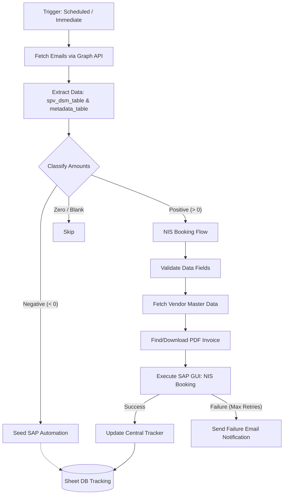

# NIS Booking Module

This directory contains the `nis_booking` module, which is responsible for automating the extraction of DSM statements from emails, classifying the financial data, executing the NIS Booking process in SAP, and updating the SharePoint/Google Sheets tracker.

**Note:** This module handles the positive payable amounts (NIS Bookings) directly. If there are negative amounts (Receivables) that require SAP Checklist generation, this module will seed the tasks as "pending" for the independent `sap_automation` module to process later.

## Overview of the Flow

The module executes a precise linear pipeline for each valid email detected:



1. **Email Reading (`read_email.py`)**: Connects to the mailbox via Microsoft Graph API and fetches recent emails (based on lookback days) looking for DSM-related subjects.
2. **Extraction (`classified_html_table_parser.py`)**: Scans the email body HTML for the most complete metadata and DSM tables. If any DSM row still lacks an SPV name, it retries that field through the configured LLM; unresolved extraction failures remain retryable on later mailbox scans.
3. **Classification**: Evaluates the amounts for fields like `total_dsm_charges_payable`, `drawl_charges_payable`, `revenue_diff`, and `revenue_loss`:
   - **Positive Amount (> 0)**: Directed to the NIS Booking flow.
   - **Negative Amount (< 0)**: Directed to SAP automation (marked as pending).
   - **Zero / Blank**: Ignored/Skipped.
4. **Validation**: Ensures all critical data fields (dates, week numbers, SPV names, and at least one non-zero amount) are present.
5. **Vendor Master Data (`read_vendor_master_data.py`)**: Fetches SPV-specific banking and vendor details (Company Code, Vendor Code, Bank Key, Cost Center, Plant, GL Account).
6. **NIS Booking (`nis_booking.py`)**: 
   - Locates the attached PDF invoice (or downloads it from the SharePoint booking folder).
   - Automates the SAP GUI to post the NIS transaction for the positive amounts.
   - Saves the generated NIS Number/Checklist ID.
   - Features an automatic retry mechanism (up to 3 times) and triggers a failure notification email if it fails completely.
7. **Tracker Update (`add_new_row_data_nis.py`)**: Updates the centralized tracker with the newly generated NIS numbers, dates, and email reception metadata for incremental week rows.

## Triggers and Execution Modes

The `nis_booking` module operates as a continuously running service or as a one-off immediate task.

### 1. Scheduled Mode (Default)
The module polls the email inbox at a regular interval.
```bash
python main.py --mode scheduled --interval 300 --lookback 2
```
- **`--interval`**: Polling frequency in seconds (default: 300 seconds / 5 minutes).
- **`--lookback`**: The number of past days to scan for emails (default: 2 days).
- In this mode, the script sleeps between iterations and continuously scans for newly arrived emails, processing them through the pipeline.

### 2. Immediate Mode
A one-shot execution to process emails within a specific timeframe and exit.
```bash
python main.py --mode immediate --lookback 2
```
- Will attempt to resume any previously incomplete runs.
- Scans for new emails within the lookback window.
- Executes the pipeline for detected emails and terminates.

### Launch Script

A convenient `launch.py` script is provided to simplify execution. It automatically resolves and installs dependencies from `requirements.txt` before invoking the main scheduled loop.

```bash
python launch.py
```

## State Management and Error Handling

The state of every pipeline step is tracked persistently in a local **SQLite database** (`nis_booking.db`, managed by `db_manager.py`). This replaces the older SharePoint/Excel tracker (`sheet_db_manager_sp.py`) for the NIS booking service.

The database stores:
- **`email_runs`** — one record per email (keyed by the email `message_id`), holding email-level metadata and overall status.
- **`booking_rows`** — one record per SPV row inside an email, with its own unique `row_id`; all rows from the same email share the same `message_id`. Before NIS submission, rows from that email with the same non-empty vendor cost center are combined into one booking unit and share one NIS number. Different or unresolved cost centers remain separate.
- **`run_steps`** — fine-grained per-step tracking (extraction, classification, vendor read, NIS booking, tracker update) used for crash-resume.

**SharePoint usage** is limited to three things only — it is no longer used for run tracking:
- `DSM-NIS-INPUT.xlsx` (input data)
- `DSM-NIS-OUTPUT.xlsx` / `NEW-DSM-NIS-Booking.xlsx` (booking output / tracker)
- the **`nis_completion_recipients`** workbook (`recipients_sp.py`) holding failure/completion email recipients. If that sheet is empty or unreachable, the service falls back to `config.NIS_COMPLETION_RECIPIENTS`.

Behaviour:
- If the script fails or restarts, it resumes from the last incomplete step and re-picks only the booking rows that are still pending or failed.
- Step/row failures trigger automated email notifications (if configured) containing the run details, SPV name, and error trace.

## Debit/Credit Note flow (5-row DSM table trigger)

When a DSM email's SPV table contains exactly `config.DEBIT_CREDIT_TRIGGER_ROW_COUNT`
(default **5**) valid SPV rows, the automation additionally drives a Debit/Credit
Note exchange with the Finance team. This runs alongside the normal NIS/SAP
booking and never blocks it.

Flow:

1. **Detect** — during `_prepare_run`, after the SPV table is extracted, `debit_credit_email.should_send()` checks the valid (non-Total) row count. On a match a **pending** record is written to the new `debit_credit_emails` table (one per DSM email, keyed by `message_id`). Nothing is emailed yet.
2. **Book first** — the run's normal booking runs next: NIS for the positive amounts and the SAP checklist for the negative amounts.
3. **Send (gated)** — only once `_is_run_ready_for_debit_credit()` is satisfied (every SPV booking row is terminal **and** all SAP checklist steps are complete) does `send_ready_debit_credit_emails()` build and send the "Debit/Credit Notes" email. The body (`debit_credit_email.build_html`) mirrors `send-debit-credit-email-finance/Debit_Credit Notes.eml`: a transposed table (one column per SPV), Indian-formatted amounts (e.g. `21,63,738.00`), and a header block with the total DSM amount, company code and CN/DN due date. It goes to the **finance_team** recipients, and the send is retried each loop until it succeeds.
4. **Track reply** — finance replies with the Debit/Credit Note PDFs (typically 3). `_handle_debit_credit_reply()` matches the reply back to its record (by subject marker), downloads the PDFs, uploads them to `<booking_folder>/Debit-Credit-Notes/` on SharePoint, and records them on the tracking row.

### Finance recipients

Read from the SharePoint workbook `automation_sheet_db.xlsx` (`config.SHEET_DB_PATH`),
sheet **`finance_team`**, single column header **`emails`** (one address per row or a
comma/semicolon separated list) — see `finance_recipients_sp.get_finance_recipients()`.
Falls back to `config.FINANCE_TEAM_RECIPIENTS` if the sheet is empty/unreadable.

### `debit_credit_emails` table

| Column | Meaning |
|---|---|
| `id` | autoincrement PK |
| `run_id`, `message_id` | the originating DSM email (UNIQUE `message_id`) |
| `spv_name`, `week_no`, `from_date`, `to_date` | snapshot of the trigger email |
| `dsm_amount`, `company_code`, `due_date_cn_dn` | values shown on the email header |
| `recipients`, `sent_subject` | finance recipients + the exact subject sent |
| `email_status` | `pending` → `done` (sent) / `failed` |
| `sent_at` | timestamp of a successful send |
| `reply_message_id`, `reply_received_at` | the finance reply that carried the PDFs |
| `reply_pdf_names`, `reply_pdfs_uploaded` | downloaded PDF names + uploaded flag |
| `booking_folder_path` | where the reply PDFs are stored on SharePoint |
| `error_message`, `created_at` | last error + creation timestamp |

### Configuration (config.py)

`DEBIT_CREDIT_ENABLED`, `DEBIT_CREDIT_TRIGGER_ROW_COUNT`, `DEBIT_CREDIT_SUBJECT`,
`DEBIT_CREDIT_SUBJECT_KEYWORD`, `DEBIT_CREDIT_COMPANY_CODE`,
`DEBIT_CREDIT_REPLY_SUBFOLDER`, `FINANCE_TEAM_SHEET`, `FINANCE_TEAM_FILE_NAME`,
`FINANCE_TEAM_SP_FOLDER`, `FINANCE_TEAM_RECIPIENTS`.

> **Assumptions to confirm with the business:** column order follows the source
> email's row order and column headers use the raw `spv_name` values (the sample
> finance email uses hand-curated short labels in a reordered sequence). `C. Code`
> comes from `DEBIT_CREDIT_COMPANY_CODE` (blank unless set). `Due Date CN/DN` uses
> the email's `due_date` reformatted to `dd/mm/yyyy`. Adjust these in
> `debit_credit_email.py` / `config.py` if Finance needs the exact template wording.
